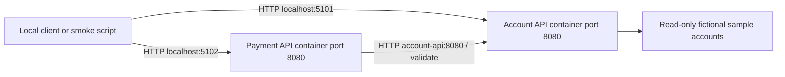
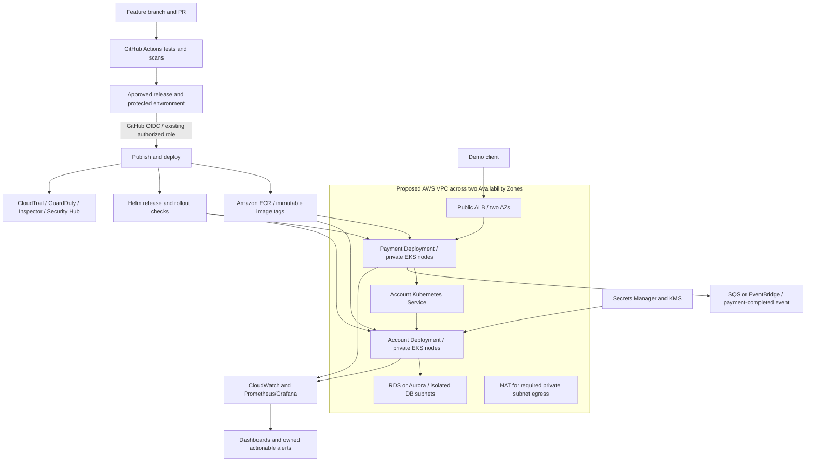

# Architecture and repository layout

Project name: Banking Release Platform. Local workspace: `bank_system_week4_project_mahmoudhachem`. Confirmed GitHub identity: [mhachem110/BankingReleasePlatform-AWS-EKS](https://github.com/mhachem110/BankingReleasePlatform-AWS-EKS). No remote existed at initial inspection; `origin` now points to the confirmed repository. This is a new project, separate from CloudOpsTracker.

## Implemented Phase 1 architecture



Compose creates a project network and resolves the service name `account-api`. Each API has its own image and process. Only loopback ports on the host are exposed. Both APIs also run directly using .NET, with Payment configured to call Account on port 5101. No database or AWS resources exist in Phase 1.

## Proposed final architecture after later approvals

This diagram is a design target, not deployed infrastructure. Start with one development environment; stage/production promotion is required before final acceptance and will be approved separately.



ECR stores the images; EKS runs Kubernetes; Helm describes the application resources and releases; an ALB routes external HTTP requests; Kubernetes Services provide stable internal names. Terraform will manage approved AWS resources. OIDC exchanges GitHub identity for short-lived AWS credentials. Its trust policy controls who assumes the role, while permission policies control AWS actions.

An S3 state bucket is an AWS service, not a VPC subnet resource. Its bootstrap and reuse decision are deferred to Phase 2. The existing Actions role's trust and permissions, customized OIDC subjects, permission boundaries, SCPs and PassRole restrictions require inspection. An administrator may need to supply distinct EKS cluster, node and controller roles. No role creation is implemented here.

## Current repository structure

```text
BankingReleasePlatform.sln
Directory.Build.props
global.json
compose.yaml
.github/
  PULL_REQUEST_TEMPLATE.md
apps/
  Account.Api/          # API, repository, validation, Dockerfile, NuGet lock
  Payment.Api/          # API, HTTP client, simulation, Dockerfile, NuGet lock
tests/
  Account.Api.Tests/    # endpoint and validation tests
  Payment.Api.Tests/    # endpoint and dependency failure tests
scripts/
  smoke-test.ps1        # checks running APIs
  test-local.ps1        # launches native processes and cleans them up
docs/
  architecture.md
  assignment-requirements.md
  reference-project-review.md
  phase-1-report.md
  phase-1-pr.md
README.md
```

## Future folders reserved in the design

These are proposed paths, not implemented scaffolding:

```text
infra/bootstrap/                 # approved S3 state foundation, Phase 2
infra/modules/                   # reusable AWS modules, Phase 3+
infra/environments/dev/           # development configuration, Phase 3+
helm/account-api/                 # reusable Helm application chart, Phase 4
helm/payment-api/                 # reusable Helm application chart, Phase 4
.github/workflows/                # validation and controlled deployment, Phase 2/5
docs/evidence/                   # scans, dashboards, costs, final verification
docs/runbooks/                   # rollback, failure recovery and cleanup
```

No Terraform, Helm chart or release workflow has been implemented. Later work will add folders only as their approved phases begin.
