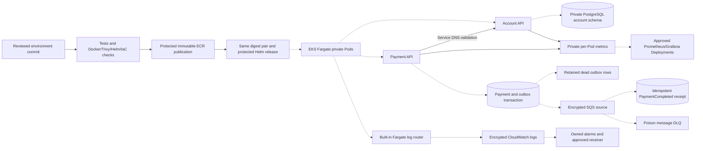
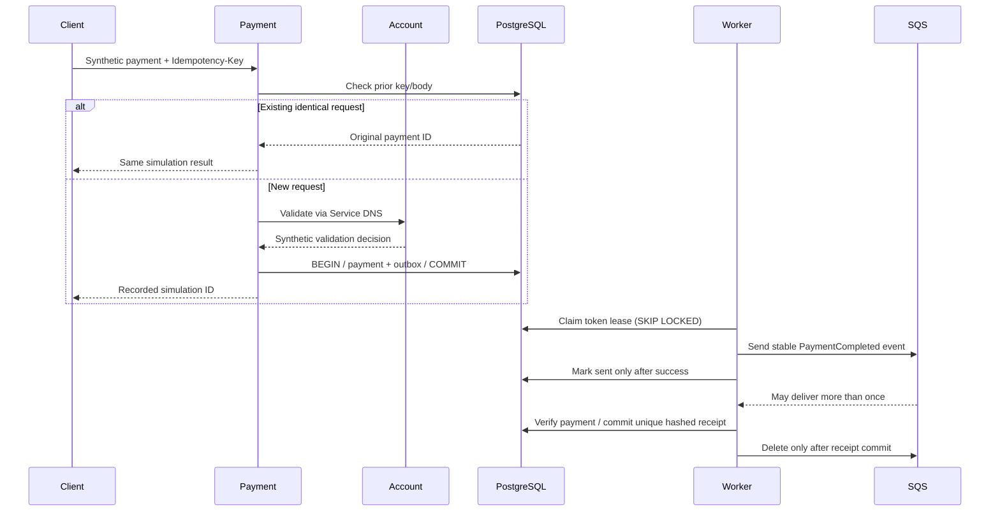

# Banking release and operations architecture

Prepared target. Local API/PostgreSQL/SQS-compatible behavior is tested; dashed
cloud components remain pending approved deployment and live acceptance.

The Payment API validates an account through Kubernetes DNS, then records a
simulation and its outbox event atomically. It never debits accounts or moves funds.
The outbox worker sends to standard SQS, and the consumer commits a stable receipt
before deleting the message. Source/DLQ redrive and dead outbox recovery are distinct.

GitHub deployer, Fargate execution, application runtime IRSA and human/migration
identities are separate. Runtime database identities have no DDL ownership.
Production PostgreSQL verifies TLS hostname/CA. Secrets are mounted from approved
operator-managed Secrets; the chart does not invent AWS identities or passwords.
Only Payment mounts a service-account token when separately approved messaging is
enabled. Prometheus has namespace-only read access for annotated Pod discovery.
No EC2 nodes, DaemonSets, Pod Identity or Fargate NetworkPolicy enforcement is assumed.

Rollout failure restores the prior Helm revision and digest pair. Schema migrations
are forward-only and must remain compatible with the prior image. Rollback never
deletes/reseeds durable payment data. External ALB/HTTPS, RDS/SQS/KMS/IAM, logging,
collector Pods, notification routing and all extra environment costs remain gated.
