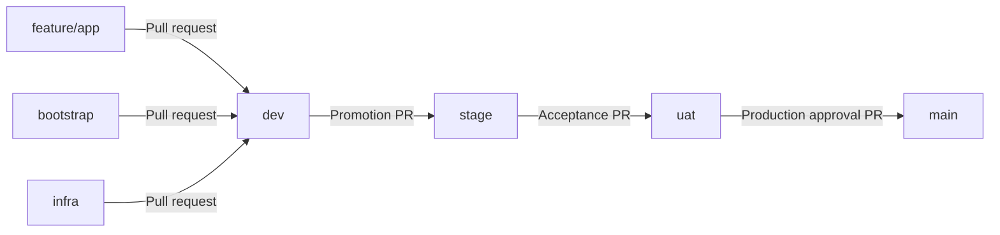

# Repository governance checkpoint

> Historical governance preparation snapshot. PRs #1–#11 are merged. The trusted
> policy is installed and Repository security policy is required on dev; the seven
> rulesets remain Active. Bootstrap is configured and Phase 2 has historical live
> completion evidence. Later app environments and live Phase 3 deployment remain
> pending. Read [the current reconciliation](../infrastructure/RECONCILIATION.md)
> before using the dated setup/activation instructions below. Do not repeat the
> completed migration or weaken any current gate.

Repository: https://github.com/mhachem110/BankingReleasePlatform-AWS-EKS

## Branches and common baseline



`main` is the production-approved branch. `dev` is now the repository default so ordinary working-branch PRs default to development, and the manually dispatched bootstrap workflow can become available after a reviewed merge into dev. Always verify the PR base explicitly. `dev`, `stage`, and `uat` were created at the existing `main` commit `43a9ddba5b965b96fb9a5535cb67604e3b85ff1c`. This empty initial commit is the common baseline. No application code was promoted and no history was rewritten. PR #1 now targets `dev` and remains open. The old Phase 1 publication notes describe the earlier target; this governance checkpoint supersedes that target and the old instruction to start Phase 2 from merged main.

Use merge commits for feature and promotion PRs. Squashing or rebasing repeated promotions can disconnect ancestry and make later promotions appear to contain changes already released. Linear-history enforcement is intentionally off. Promotion PRs move all changes since the prior promotion; examine the entire diff and freeze the source branch during a release window. A commit SHA identifies the release; names such as `stage` move over time.

## Active versus prepared controls

The four `rulesets/*.json` files describe the live branch rulesets applied at this checkpoint. Each uses an exact branch ref and active enforcement, with no bypass actors:

| Control | dev | stage | uat | main |
| --- | --- | --- | --- | --- |
| Pull request required | Active | Active | Active | Active |
| Branch deletion blocked | Active | Active | Active | Active |
| Force pushes blocked | Active | Active | Active | Active |
| Review conversations resolved | Active | Active | Active | Active |
| Merge commits only | Active | Active | Active | Active |
| Required approving reviews | 0 | 0 | 0 | 0 |
| Required CI/security status checks | Pending | Pending | Pending | Pending |
| Required code-owner review | Pending reviewer | Pending reviewer | Pending reviewer | Pending reviewer |
| Route/file-scope enforcement | Prepared | Prepared | Prepared | Prepared |

Zero required approving reviews is deliberate for a single developer: PR authors cannot approve their own PRs. You still review the diff and explicitly merge the PR. There is no independent second-person approval today. Once a second reviewer with write access is available, set at least one approval on each ruleset, retain stale-review dismissal, and enable approval of the most recent push by someone else. Consider two independent reviewers for production when the team can support it. No administrator bypass is configured, although repository administrators can edit settings; this is not separation of duties against the sole administrator.

The policy workflow runs on every PR targeting these branches, including retargeted PRs, without path filtering. It accepts only same-repository `feature/app -> dev`, `bootstrap -> dev`, `infra -> dev`, `dev -> stage`, `stage -> uat`, and `uat -> main` PRs. Its route job uses metadata with empty token permissions. Its file job checks out only the immutable trusted `github.sha` from `pull_request_target`, with a pinned checkout action, no persisted credentials, and only contents/read and pull-requests/read permissions. It never checks out, imports or executes PR code. The Python validator reads every changed path, checks rename source paths, detects incomplete/racing API results and requires the verified cloud owner to author cloud/promotion PRs. The always-running **Repository security policy** job fails unless both policies succeed. No AWS secrets, environment or OIDC token is granted. Until this workflow is merged into default dev and its aggregate check is observed and required on each destination, it is prepared, not a live required merge gate.

Two additional active update-only rulesets now limit `bootstrap`/`infra` pushes to the verified cloud owner and protected-branch updates to that owner through PRs. Their narrowly scoped actor entries do not bypass the separate PR, deletion, force-push, conversation or future required-check rules. The original five rulesets remain unchanged. See [the security checkpoint](security.md) for ownership, exact controls, deployment planning and limitations.

No nonexistent checks were added. Phase 1 application CI, container/security scanning, deployment checks, and all AWS environments remain unconfigured. The Phase 2 feature PR supplies credential-free Terraform validation and Checkov, but those checks are not globally required at this checkpoint. An optional check failure does not block GitHub's merge button; do not merge a PR with failing checks.

## Exact GitHub settings and check activation

Open repository **Settings -> Rules -> Rulesets**. There are four branch rulesets named `banking-dev-governance`, `banking-stage-governance`, `banking-uat-governance`, and `banking-main-governance`. To recreate one, use **New ruleset -> Import a ruleset**, select the matching complete JSON under `docs/governance/rulesets/`, confirm **Active**, its exact target branch, and an empty bypass list, then save. Alternatively use **New branch ruleset**, select the exact branch, enable **Restrict deletions**, **Block force pushes**, **Require a pull request before merging**, **Require conversation resolution**, zero approvals and **Merge** as the only allowed merge method. Leave **Restrict updates**, linear history, and required deployments off; Restrict updates with no bypass would prevent PR merges too.

First follow the approved migration order in [the reusable-branch runbook](https://github.com/mhachem110/BankingReleasePlatform-AWS-EKS/blob/infra/docs/governance/reusable-branches.md): original PR #1, original PR #3, this governance PR #2, then the migration PR from infra. No merge is authorized by this document. Installing the strict policy before merging the two legacy-source PRs would cause their routes to fail. After you manually merge governance into `dev`:

1. Synchronize each reusable working branch with `dev` using a normal merge if needed, and confirm **Repository security policy**, **Branch promotion policy** and **File ownership and path validation** ran successfully on a PR targeting `dev`. Trigger a fresh run through a normal synchronization push when necessary. Do not close/reopen existing PRs without approval or dispatch an AWS workflow.
2. In the `dev` ruleset, enable **Require status checks to pass**, choose the observed **Repository security policy** aggregate with **GitHub Actions** as its source, and save. Do not invent a check name or require a workflow that has not run. Use up-to-date checking for working PRs into `dev` when available.
3. After the trusted policy is merged into default dev, open the first `dev -> stage` PR and verify **Repository security policy** actually ran successfully for that PR. Then add that observed check to the stage ruleset before manually merging. Repeat for `stage -> uat` and `uat -> main`. Require the GitHub Actions source, and never add a check before a real run for that destination has been verified. Application CI still needs its executable configuration promoted to each branch as it becomes available; do not assume all CI can run merely because the metadata-only routing policy can.
4. When application CI and security scanning are implemented in Phase 5, make stable, always-running aggregate jobs report failures from tests/scans and safe success when a check is legitimately inapplicable. Confirm each job has run against each destination before requiring its observed status. Workflows skipped by path or branch filtering can leave required checks pending forever. Do not blanket-require the path-filtered Terraform validation job for application-only PRs.
5. Recheck each PR's base, source, diff, CI/security results and unresolved conversations before merging. Do not enable automatic merging at this checkpoint.

For promotion branches, leave strict up-to-date checking off initially: merging `dev -> stage` creates a merge commit unique to `stage`. A strict rule would demand a backward merge into `dev`, which conflicts with the approved one-way routing. Retest the synthetic PR merge commit and use merge commits to preserve ancestry. If a merge conflict occurs, stop the promotion and design a reviewed release synchronization procedure rather than force pushing or bypassing routes.

## Daily development and promotion

Reuse exactly these working branches; do not create feature/phaseN branches:

| Working branch | Scope |
| --- | --- |
| `feature/app` | Account/Payment APIs, tests and Docker; no Helm, Terraform, IAM or workflows |
| `bootstrap` | Terraform backend, state, GitHub OIDC and bootstrap configuration |
| `infra` | VPC, EKS, ECR, networking, RDS, monitoring, Helm, workflows and shared governance |

A branch is a reusable workstream, not a deployment environment or an access grant. All three may contain the shared repository after synchronization; scope means which files you change, not which files the branch may contain.

With a clean worktree, after a merged PR and before the next change:

```powershell
git fetch origin
git switch feature/app # Or bootstrap / infra, matching the work.
git merge --ff-only origin/feature/app # Use the matching remote branch.
git merge --no-edit origin/dev
# Resolve any conflicts, review, and run relevant checks before pushing.
git push origin feature/app
```

Stop if any command fails; do not force push, reset away commits, or rebase shared history. Repeat synchronization whenever dev has advanced before starting new changes. Keep automatic branch deletion disabled and do not click Delete branch on these reusable branches.

In **Pull requests -> New pull request**, explicitly select base `dev` and compare `feature/app`, `bootstrap`, or `infra`. Review and resolve comments, then use **Create a merge commit** after your checkpoint approval. No new phase branch is needed. Nobody should push directly to `dev`, `stage`, `uat`, or `main`.

For release promotion open these PRs separately, review the full diff and evidence, and merge only after the previous environment has been validated:

1. Base `stage`, compare `dev`.
2. Base `uat`, compare `stage`.
3. Base `main`, compare `uat`.

These names reserve future environments; they do not create three additional EKS clusters. Only one development environment is in the initial AWS scope. A branch merge records code approval. Deployment requires its own environment gate and does not occur until deployment workflows exist and AWS actions are explicitly authorized. Later, promote the tested immutable image digest across environments instead of rebuilding different images for each branch.

## Environments and AWS OIDC (planned, no AWS changes)

| GitHub environment | Allowed deployment branch | Purpose |
| --- | --- | --- |
| dev | dev | Initial lab application deployment |
| stage | stage | Future integration/release verification |
| uat | uat | Future user acceptance testing |
| prod | main | Future production-approved deployment |
| bootstrap | dev | Manually approved Phase 2 infrastructure plan/apply |

These environments have NOT been created. To configure an approved environment later: **Settings -> Environments -> New environment**, use its exact name, choose **Selected branches and tags**, add its exact branch as a **Branch** (not Tag), and add required reviewers for each cost-incurring job. Disable administrator bypass. For a sole developer who must approve their own run, leave **Prevent self-review** unchecked and document this single-person lab approval. When another authorized approver is available, enable it for prod and bootstrap. GitHub requires only one of the listed environment reviewers to approve; this is not a multiple-reviewer quorum. Keep environment-specific role/configuration variables there; no long-lived AWS access keys.

The Phase 2 workflow uses only `bootstrap`, manually dispatched from `dev`, with an explicit disabled-by-default switch and separate plan/apply approval gates. GitHub requires a dispatchable workflow on the default branch; choosing dev as default makes it available after you review and merge the Phase 2 PR into dev, without promoting unvalidated infrastructure code to production first. This reviewed development branch is appropriate for the first development state backend. `main` approval governs production application promotion; the bootstrap role is not a general application production role. Environment approval must be obtained before its job receives an OIDC token. GitHub approval does not itself expand AWS IAM permissions.

The repository's verified immutable OIDC prefix is `repo:mhachem110@150286776/BankingReleasePlatform-AWS-EKS@1413860979`. An environment job's subject appends `:environment:bootstrap`, `:environment:dev`, `:environment:stage`, `:environment:uat`, or `:environment:prod`. Treat these as proposed exact subjects; reverify the repo OIDC settings before an AWS change. Using an environment replaces the branch part of the subject, so exact GitHub environment deployment branch restrictions are essential. Also require `aud = sts.amazonaws.com` in AWS trust conditions.

The existing role's supplied trust currently allows only the previous Retail project's `bootstrap` subject. It does not yet authorize Banking. Preserve that existing statement. The pending Phase 2 trust addition authorizes only Banking `bootstrap` after reuse/update authorization is confirmed. Do not add wildcard trust for all branches/environments or assume this bootstrap role is authorized for application deployment. Future deployment subjects and least-privilege roles require separate review; EKS cluster and node roles must be administrator-provided if role creation is prohibited.

Trust policy determines **who can assume a role**; permission policy determines **what that role can do in AWS**. Environment gates control **when GitHub runs a deployment**. All three must agree. The full existing permission JSON, approved state bucket/Region, provider confirmation, role reuse/update authorization and later PassRole/EKS prerequisites remain pending. No live AWS configuration was inspected or modified for this checkpoint.

## Verification and review

Inspect **Branches**, PR #1's base, and **Settings -> Rules -> Rulesets**. Check exact targets, Active status, zero reviews, resolved conversations, deletion/force-push blocking, and merge-only methods. The original five rulesets have no bypasses; the two separate update-only authority guards use only the verified owner, with PR-only mode on protected refs. The baseline and open PRs can be verified through the GitHub REST API. No destructive push tests are needed.

Native rulesets were read back from GitHub; original protections remain intact. Actionlint and 23 Python security-policy tests pass locally. The routing shell step is exercised with six valid and 26 invalid route/repository combinations, and the aggregate is tested against success, failure, cancellation and skipped dependencies. The final trusted-default-branch workflow cannot run on the initial governance PR because empty default dev does not yet contain it. Live execution and required-check activation remain pending the reviewed merge and the steps above. Phase 2's credential-free Terraform validation previously completed successfully on draft PR #3 in GitHub Actions. No AWS deployment or authorization test ran.

Open review items: [Phase 1 PR #1](https://github.com/mhachem110/BankingReleasePlatform-AWS-EKS/pull/1), [governance PR #2](https://github.com/mhachem110/BankingReleasePlatform-AWS-EKS/pull/2), and [Phase 2 draft PR #3](https://github.com/mhachem110/BankingReleasePlatform-AWS-EKS/pull/3). All target dev; none was merged. The Phase 2 draft remains pending IAM/backend inputs.

Review all PRs before any merge. To preserve the original PRs, merge their legacy application/bootstrap work before this strict governance policy, as documented in the migration runbook. Merging them requires your explicit checkpoint approval. Phase 2 has no application code and is based on the same empty `dev` baseline, not on an unapproved Phase 1 merge. Its ignore rules preserve the Phase 1 exclusions. Do not run Terraform operations while reviewing these PRs.

References: [GitHub rules](https://docs.github.com/en/repositories/configuring-branches-and-merges-in-your-repository/managing-rulesets/available-rules-for-rulesets), [deployment environments](https://docs.github.com/en/actions/how-tos/deploy/configure-and-manage-deployments/manage-environments), [trusted PR event context](https://docs.github.com/en/actions/reference/workflows-and-actions/events-that-trigger-workflows#pull_request_target).

## Reusable-branch migration checkpoint

The former feature wildcard strategy is superseded by exactly three working branches: feature/app, bootstrap and infra. Existing PR heads remain as temporary compatibility references to preserve reviews and commit history; no legacy branch is renamed, deleted, closed or replaced. Their retirement requires a later explicit approval. See [migration PR #4](https://github.com/mhachem110/BankingReleasePlatform-AWS-EKS/pull/4) for the exact sequence. The new active banking-working-branches ruleset blocks deletion and force pushes on exactly feature/app, bootstrap and infra while allowing ordinary development/synchronization pushes; its complete JSON is included in PR #4. Automatic head deletion remains disabled. The four live environment rulesets are unchanged, and no required checks are removed or invented. Branch bootstrap is separate from the GitHub environment named bootstrap: AWS operations remain manually dispatched from reviewed dev, with environment approvals and OIDC/IAM authorization handled independently.
