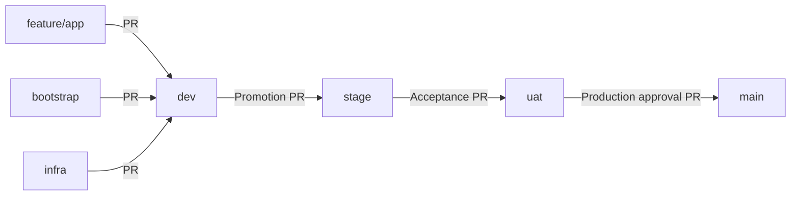

# Reusable working branches and safe PR migration

Current status verified 12 October 2026: PRs #1–#11 are merged, including the completed reusable-branch migration and scoped owner-authored application release policy. Phase 2 has historical live completion evidence; Phase 3 deployment remains pending. The migration sequence and verification narrative below preserve the earlier checkpoint history and do not authorize repeating merges/setup or retiring original PR heads. See [the current reconciliation](../infrastructure/RECONCILIATION.md).

## Target structure



| Branch | Workstream | Created from |
| --- | --- | --- |
| `feature/app` | APIs, tests, Docker and application docs; approved owner-authored Helm/deployment paths and four app workflows per AGENTS.md; no Terraform/IAM/generic GitHub configuration | Original PR #1 application history |
| `bootstrap` | Terraform backend, S3 state and GitHub OIDC/bootstrap work | Original PR #3 bootstrap history |
| `infra` | VPC, EKS, ECR, networking, RDS, monitoring, Helm, workflows and governance | Existing dev baseline; this migration PR adds governance files only |

`dev` remains the repository default. `stage`, `uat` and `main` retain their original histories and protections. dev now includes the approved application, bootstrap and governance merges; stage, uat and main retain the initial baseline. No environment promotion has occurred. After synchronization, a working branch contains the shared repository; its workstream controls what you change, not what files it may contain.

## Why existing PR heads are retained

GitHub [closes an open PR when its source branch is renamed](https://docs.github.com/en/repositories/configuring-branches-and-merges-in-your-repository/managing-branches-in-your-repository/renaming-a-branch). Changing a PR's base does not change its source. Renaming/replacing the existing heads would disrupt PR continuity.

The original branch names are therefore retained as temporary compatibility references. No existing PR is closed or replaced, no source branch is renamed or deleted, and no history is rewritten. The new application/bootstrap branches preserve the original commit ancestry. An additive application ignore-file commit was mirrored to PR #1 with an ordinary fast-forward push to remove a verified add/add conflict; no application code changed.

Do not start new work on the old phase branches. Retiring them is a separate future decision after their PRs are merged and ancestry is verified, requiring explicit owner approval. It is safe to leave those historical references in place while using only the three working branches for new work.

## PR status at this checkpoint

| PR | Source -> target | Status and purpose |
| --- | --- | --- |
| [#1](https://github.com/mhachem110/BankingReleasePlatform-AWS-EKS/pull/1) | feature/phase1-banking-apis -> dev | Merged at e0beff1; application history preserved on feature/app |
| [#2](https://github.com/mhachem110/BankingReleasePlatform-AWS-EKS/pull/2) | feature/repository-governance -> dev | Merged at 3db5bcc; trusted route/file workflow and CODEOWNERS installed in dev |
| [#3](https://github.com/mhachem110/BankingReleasePlatform-AWS-EKS/pull/3) | feature/phase2-terraform-bootstrap -> dev | Merged at ab58a7f; reusable bootstrap synchronized after its merge; AWS execution remains unapproved |
| [#4](https://github.com/mhachem110/BankingReleasePlatform-AWS-EKS/pull/4) | infra -> dev | Adds the runbook, persistent agent instructions, ignore safeguards and working/authority ruleset configurations; no replacement of PRs #1-#3 |

The executable security policy is updated in existing PR #2. This separate infra PR records how to adopt it without breaking the original reviews. Its full [security report](https://github.com/mhachem110/BankingReleasePlatform-AWS-EKS/blob/feature/repository-governance/docs/governance/security.md) separates active native controls from prepared policy enforcement.

## Migration order and remaining approvals

Review all changes first. Do not perform these merges until the owner approves the sequence. Use **Create a merge commit** in every PR; do not squash, rebase, bypass protections, or enable auto-merge.

1. **Merge original PR #1 into dev.** Then fetch and synchronize `feature/app` with its matching remote and `origin/dev` using the reusable commands below. This preserves the original application PR's review history.
2. **Prepare and review original draft PR #3.** Its offline code may be accepted without authorizing AWS operations, but it must remain draft until the owner approves its preparation scope. Before merging, synchronize `bootstrap` with the latest dev and mirror that normal merge to the original PR source once, using the commands below. This updates the existing PR, rather than replacing it. Check its final diff and credential-free CI, then mark it ready and merge it into dev only after approval. Synchronize `bootstrap` with dev again after that merge. All pending IAM/backend inputs remain pending, and AWS operations stay disabled.
3. **Synchronize and merge original PR #2 into dev.** Fetch, switch to its legacy governance head, merge its matching remote and `origin/dev`, review the final diff and conflict resolutions, then push normally. Inspect the exact route list and retained protections before approving its merge. This is the one-time installation of the strict policy into default dev. No wildcard or legacy-route exception is added. Do not install it before steps 1-2: it would reject the original application/bootstrap source branch names.
4. **Synchronize infra with dev and merge this migration PR.** Its source is already `infra`, so the installed policy allows it. Confirm **Branch promotion policy**, **File ownership and path validation**, and **Repository security policy** actually run successfully on its current head. After that real run, require the observed **Repository security policy** aggregate with GitHub Actions as expected source on the dev ruleset before merging this PR. Recheck the diff and all existing required checks, then merge only after approval. Synchronize infra with dev again afterward.
5. **Refresh all three working branches before later work.** Use feature/app, bootstrap or infra according to scope, open the next PR into dev, and reuse that branch again after each merge. No further feature/phaseN branches are created.
6. **Promote only approved changes** using dev -> stage, stage -> uat, and uat -> main PRs. Verify the route check on each actual promotion PR before requiring its observed status on that destination. Do not activate missing CI/security checks. Deployment and acceptance evidence are separate from the branch merge; the initial project still provisions only one development environment after explicit approval.

If the owner prefers strict governance to be installed before PRs #1 and #3 are merged, STOP and request approval for replacement PRs from feature/app and bootstrap. That alternative would preserve commits but require linking/replacing the original PR reviews. No such replacement is performed by this checkpoint.

## Reusable synchronization commands

Run each command separately with a clean worktree; stop on any error. These commands push to the working branch only, never directly to dev/stage/uat/main. A normal merge preserves both histories. Do not make new changes until synchronization is complete.

Application:

```powershell
git status --short
git fetch origin
git switch feature/app
git merge --ff-only origin/feature/app
git merge --no-edit origin/dev
git push origin feature/app
```

Bootstrap:

```powershell
git status --short
git fetch origin
git switch bootstrap
git merge --ff-only origin/bootstrap
git merge --no-edit origin/dev
git push origin bootstrap
```

Infrastructure/governance:

```powershell
git status --short
git fetch origin
git switch infra
git merge --ff-only origin/infra
git merge --no-edit origin/dev
git push origin infra
```

If conflicts arise, stop, review and resolve them without dropping work, stage only the reviewed files, complete the merge, run relevant checks, and then push. Keep the shared `.gitignore` exclusions from all workstreams. A clean offline Git merge-tree simulation now succeeds for the application and bootstrap histories after their ignore rules were aligned; it does not guarantee later unrelated changes will never conflict.

One-time PR #3 compatibility push, after bootstrap synchronization in step 2 and before its approved merge:

```powershell
# Run while checked out on bootstrap. This is an ordinary push, not force.
git push origin HEAD:feature/phase2-terraform-bootstrap
```

If rejected as non-fast-forward, stop and inspect newly arrived commits. Do not override the rejection. After PR #3 merges, stop pushing to that old head; reuse bootstrap only.

One-time governance PR #2 synchronization in step 3:

```powershell
git fetch origin
git switch feature/repository-governance
git merge --ff-only origin/feature/repository-governance
git merge --no-edit origin/dev
git push origin feature/repository-governance
```

This is maintenance of the existing PR, not creation of another workstream. After PR #2 merges, future governance changes use infra.

## Rulesets and activation

The four environment branch rulesets remain unchanged: PRs required, conversation resolution required, deletion and force pushes blocked, merge commits only, zero approvals for the sole-developer lab, and no bypass actors. No existing required checks are removed. At inspection there were no required statuses configured, and the strict routing workflow was not yet installed in default dev.

The existing `banking-working-branches` ruleset targets **exactly** `refs/heads/feature/app`, `refs/heads/bootstrap` and `refs/heads/infra`. It blocks deletion and force pushes, has no bypass actors, and allows ordinary development commits and normal synchronization pushes. It deliberately does not require PRs into these working branches; their changes are reviewed through PRs into dev. Complete configuration is in `rulesets/working-branches.json`.

Two new Active **update-only** rulesets strengthen authority without changing any of those protections:

| Ruleset | Exact targets | Only authorized actor | Mode |
| --- | --- | --- | --- |
| `banking-cloud-working-authority` (24867121) | bootstrap, infra | User 150286776 (mhachem110) | Always |
| `banking-protected-merge-authority` (24867122) | dev, stage, uat, main | Same user | For pull requests only |

Their complete JSON is in `rulesets/banking-cloud-working-authority.json` and `rulesets/banking-protected-merge-authority.json`. Each contains only Restrict updates with fetch-and-merge explicitly disallowed. GitHub calls the actor entry a bypass of that guard; it does not bypass the separate no-bypass PR, deletion, force-push, conversation or future required-check rulesets. Do not copy the actor into those original rulesets or combine safeguards into an authority guard. Native owner-controlled merging supplies cloud authorization while required independent CODEOWNERS review is not yet possible. It is not independent approval by a second person.

Native file-path push rules are documented for private/internal GitHub Team repositories, not this public personal repository. The account plan was not verifiable; do not assume a paid plan. CODEOWNERS does not block commits/pushes or hide folders. Developers can eventually push application code to feature/app and submit PRs, but cannot independently merge protected branches or update cloud branches under these exact actor guards. No additional developer account or team was invented.

Inspect **Settings -> Rules -> Rulesets**. To recreate the working ruleset, use **New ruleset -> Import a ruleset**, select the complete JSON, confirm **Active** and the three exact branch targets, and save. For a manual entry, select **New branch ruleset**, name `banking-working-branches`, choose those exact branches, leave the bypass list empty, and select **Restrict deletions** and **Block force pushes**. Leave **Restrict updates** and PR requirements off for this working-branch rule.

Inspect the two authority rulesets in the same settings page; they already exist, so do not create duplicates. To restore them, import the complete corresponding JSON, confirm the exact targets and sole User actor, and leave only Restrict updates enabled. For the protected authority guard choose **For pull requests only**; for the cloud-working guard choose **Always**. The other five rulesets retain empty bypass lists.

After PR #2 is approved and merged, observe **Repository security policy** on the infra PR's current head. In **Settings -> Rules -> Rulesets -> banking-dev-governance**, add **Require status checks to pass**, select that observed aggregate with **GitHub Actions** as source, and retain all existing checks. For later promotion PRs, repeat verification before adding it on stage, uat and main. If it does not run, investigate instead of enabling a nonexistent status or weakening protection. CODEOWNERS only requests reviewers when present on the destination branch; enable required code-owner approval only after another eligible independent reviewer exists.

Do not require the path-filtered Terraform validation job for every application or documentation PR. Add future stable CI/security aggregate checks only once they exist and have demonstrably run for the destination. Keep **Settings -> General -> Pull Requests -> Automatically delete head branches** unchecked; it was already disabled at inspection. Do not click Delete branch for the reusable branches after merging.

## Branches are separate from environments and AWS authentication

The working branch `bootstrap` does not authorize AWS access and is not the GitHub deployment environment `bootstrap`. Existing workflow dispatch remains from reviewed dev, protected by the planned bootstrap environment, reviewers, an explicit disabled-by-default switch, exact OIDC subject/audience conditions and separately reviewed IAM permissions. These branch changes do not expand trust to feature/app, bootstrap or infra.

The future environment mapping remains dev/dev, stage/stage, uat/uat, prod/main, and bootstrap/dev. No environment approvals, secrets, AWS policies, account resources, Terraform plans or deployments are created or changed here. Pending Phase 2 IAM/bucket/Region prerequisites must be resolved only after the owner approves continuing that phase.

## Validation and limits

The exact executable policy accepted all six permitted routes and rejected 26 invalid route/repository combinations. The actual aggregate shell step passed all 16 dependency-result pairs; only success/success is accepted. Actionlint and 23 Python file-policy tests passed, and local trusted validation against PR #4's live API metadata passed. The five original rulesets and read-only Actions defaults were read back unchanged; both new guards are Active. The owner can push an ordinary infra commit; a second real identity was not used to test rejection. Original application/bootstrap commits remain ancestors of their reusable branches. PR #4 remains open; dev advanced through approved merges while stage, uat and main remain unchanged. PRs #1, #3 and #2 were merged with individual approval; PR #4 is unmerged. The trusted policy is installed in dev. Verify its actual PR #4 run before manual required-status activation. No AWS operation ran.
