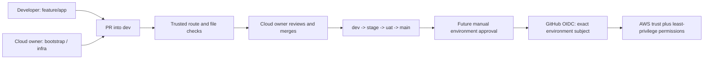

# GitHub security checkpoint

Repository: https://github.com/mhachem110/BankingReleasePlatform-AWS-EKS

## A. Repository security architecture

This is one public, personal repository. The only verified collaborator is `mhachem110`, with administrator/write access (GitHub user ID `150286776`). There are no verified developer accounts or organization teams. The account's paid plan could not be established through the available API; do not label it Free or Pro. Public-repository branch rules, CODEOWNERS and environment review features are available on GitHub's documented plans. Everyone can read this public repository; neither branches nor CODEOWNERS provide folder visibility restrictions.



The cloud owner currently holds all three responsibilities: developer, cloud engineer and repository administrator. Developers may eventually get Write access, push application changes to `feature/app` and open PRs. They cannot update the two cloud branches or independently merge protected branches under the new native guards. Only the cloud owner can authorize those updates. Administrators maintain security settings; they should not disable safeguards for routine development. Native guards enforce the current account's authority, but one person holding every responsibility is not independent approval.

Future organization migration: create actual teams named **Developers** and **Cloud Engineers**, obtain their real slugs, and grant Write access to this repository. Replace only the application ownership block with the verified Developers team, and the default/sensitive block with the verified Cloud Engineers team. Update both native update guards and the validator's cloud-author authorization to the verified team membership model. Do not insert hypothetical handles. Add at least one eligible reviewer who is different from each PR's author; enable required code-owner review only when this is possible. Organization teams require an organization, not a personal repository. Repository-wide Write access still is not folder-level write authorization.

## B. Actual rulesets

The original five rulesets were preserved. The four environment rulesets apply exactly to `dev`, `stage`, `uat`, `main` and have **Active** enforcement with no bypass entries:

| Existing protection | All four protected branches |
| --- | --- |
| Pull request required | Active |
| Direct PR-bypassing updates | Blocked |
| Branch deletion / force pushes | Blocked |
| Resolve review conversations | Required |
| Dismiss stale reviews on push | Enabled |
| Merge method | Merge commits only |
| Required approvals | 0, deliberate single-author setting |
| Code-owner / last-push approval | Off pending eligible independent reviewer |
| Required checks | None yet; observe real runs before enabling |

`banking-working-branches` blocks deletion and force pushes on exact `feature/app`, `bootstrap`, `infra`, with no bypass entries. Automatic head-branch deletion is disabled.

New **separate update-only** guards:

| Name | Target refs | Authorized actor / mode |
| --- | --- | --- |
| `banking-cloud-working-authority` | `bootstrap`, `infra` | User `150286776` (`mhachem110`), Always |
| `banking-protected-merge-authority` | `dev`, `stage`, `uat`, `main` | Same user, For pull requests only |

Each new guard contains only **Restrict updates**. GitHub calls its actor entry a bypass, but that entry passes only this update-authorization guard. The separate no-bypass protections continue to apply: it cannot authorize a force push, deletion, direct protected push, failing required check or unresolved conversation. Do not add this actor to the original rulesets or add any other rule to these authority guards. Complete API/import JSON is maintained in migration PR #4 under `docs/governance/rulesets/`.

## C. CODEOWNERS

The complete configuration is `.github/CODEOWNERS` in governance PR #2. Only the verified user appears. Applications, tests, Docker and specific local test scripts form the application block. The default owner covers unknown/shared paths; the final sensitive patterns cover Terraform anywhere, Helm, all GitHub configuration, CODEOWNERS itself, IAM artifacts, deployment/bootstrap scripts and governance documentation. Later matching patterns win, so the sensitive block deliberately comes last.

CODEOWNERS requests reviews when present on the PR's destination branch. It does not block commits or pushes. Because the author cannot approve their own PR, required code-owner review stays disabled today. Cloud-owner merge authority supplies practical authorization until an independent reviewer exists. Promote this file to each environment branch before relying on ownership review there.

## D. Infrastructure protection and shared files

`branch-governance.yml` runs on `pull_request_target` from trusted default-branch code. The route job has no token permissions. The file job checks out the immutable trusted `github.sha`, not the PR head, with a SHA-pinned checkout action and `persist-credentials: false`; its only token scopes are `contents: read` and `pull-requests: read`. It calls a standard-library Python validator that reads GitHub metadata only. No PR-provided executable, package, Terraform module or Helm chart is run in this context. No AWS token, secret or environment is granted.

| PR source into dev | Allowed changed paths |
| --- | --- |
| `feature/app` | `apps/`, `tests/`, `docs/application/`, root application Dockerfiles/Compose; explicit app build/config files, README and local application test scripts |
| `bootstrap` | `infra/bootstrap/`, `infra/backend/`, `infra/modules/state-bucket/`, `scripts/bootstrap/`, `docs/phase2/`, `iam/bootstrap/`, `policies/bootstrap/`; explicit foundation files below |
| `infra` | Cloud-owned paths; known application paths may accompany a cloud change for reviewed cross-cutting work |

All other source routes are rejected. `bootstrap`/`infra` and promotion PRs must be authored by the verified cloud owner. Application PRs cannot modify any `.github/`, Helm, Terraform, IAM, sensitive scripts, governance, CODEOWNERS or unknown paths, even when the author is the owner. Terraform/configuration suffixes are sensitive wherever located. Renames check both old and new paths. `infra` must include at least one cloud change; application-only work uses `feature/app`.

Explicit bootstrap shared exceptions: `README.md`, `.gitignore`, `.github/workflows/terraform-operations.yml`, `.github/workflows/terraform-validation.yml`, `infra/environments/dev/main.tf` and its `.terraform.lock.hcl`. The existing development foundation entry point is needed for Phase 2, but this is not permission to add networking resources there. Future resource additions belong on `infra` and need semantic review. README can be edited by all workstreams. `.gitignore`, generic workflows, AGENTS and ownership/policy changes belong on `infra`, except the listed bootstrap files. Change the allowlist only in a reviewed infrastructure/security PR. There are no application cloud-path waivers.

Generated binaries, Terraform state/real backend inputs, private key files and common credentials files fail the metadata gate. It reads all paginated filenames, rejects PRs beyond GitHub's 3,000-file endpoint limit or incomplete results, and checks metadata before/after reading for concurrent changes. These checks do not scan file contents or establish whether application behavior is safe; secret scanning and actual tests/scanners serve different purposes.

**Current enforcement:** owner-only cloud pushes and protected PR merges are native, live controls. The file/route workflow is prepared on PR #2 and becomes a merge gate only after its reviewed merge into default `dev`, a real successful check, and required-check activation. Review legacy PR diffs manually during migration. Native file-path push restrictions are documented for private/internal repositories on GitHub Team, not this public personal repository. No path push ruleset or organization team restriction was created.

## E. Future deployment security

No environments or AWS deployment pipeline were created during this task. Plan the following exact settings:

| Environment | Selected Branch rule | Required reviewer initially | Self-review |
| --- | --- | --- | --- |
| bootstrap | dev | mhachem110 | Allowed for single-person lab only |
| dev | dev | mhachem110 | Allowed for single-person lab only |
| stage | stage | mhachem110 | Allowed until another approver exists |
| uat | uat | mhachem110 | Allowed until another approver exists |
| prod | main | mhachem110 | Allowed until another approver exists |

Disable administrator bypass of environment protections. Once an independent cloud approver is available, enable **Prevent self-review**, particularly for bootstrap/prod. GitHub needs one listed reviewer, not all of them; a list is not a quorum. A sole developer preventing their own approval would block all self-triggered deployments.

Future environment secret `AWS_ROLE_ARN` identifies the **separately authorized** role; an ARN is configuration, not a long-lived AWS credential. Variables: verified `AWS_REGION`, `AWS_EXPECTED_ACCOUNT_ID`; bootstrap also `TF_STATE_BUCKET` and optional approved `TF_STATE_KMS_KEY_ARN`. Application environments later need verified EKS/ECR settings and approved workload secret handling. Keep `AWS_OPERATIONS_ENABLED` false until separately authorized. Do not publish AWS access keys or application/database secrets. No values or environments were set here, and later environments do not authorize extra AWS infrastructure.

Previously verified Banking OIDC configuration uses the immutable prefix `repo:mhachem110@150286776/BankingReleasePlatform-AWS-EKS@1413860979`; reverify it before an IAM change. Append `:environment:<exact-name>` for each table row, and require `aud = sts.amazonaws.com`. An environment subject does not encode the branch: GitHub's exact selected-branch rule supplies that restriction. The existing bootstrap role currently trusts the old Retail environment only; it is not Banking authorization. Preserve that trust. Do not add any new environment to AWS trust in this governance task.

GitHub approval controls when the job starts. OIDC trust controls who may obtain temporary role credentials. The role's IAM permission policies control what those credentials can do. All must agree; an environment cannot automatically secure an overly broad AWS trust/permission policy. The full existing IAM permission JSON and role-reuse/update authorization remain prerequisites for Phase 2. EKS cluster/node roles and later PassRole rights require separate administrator-approved prerequisites, not use of the bootstrap role as a node role.

Application PR CI must use unprivileged `pull_request`, no AWS environment/role, no `id-token: write`, and read-only permissions. Future operations use reviewed default/protected code, explicit manual authorization, scoped environment roles and `id-token: write` only on approved jobs. Terraform apply/destroy and privileged Helm are cloud-authorized operations. Never run arbitrary PR scripts after OIDC authentication. Keep plans, reviewed apply and application releases separate. This governance change neither authorizes an apply nor extends the existing bootstrap trust.

## F. Verification and required-check strategy

Local tests exercise sensitive additions/deletions/renames, cross-cutting scope, cloud author IDs, fork and legacy routes, artifacts, complete pagination, race detection and fail-closed API conditions. Run:

```powershell
python -m unittest discover -s scripts/governance/tests -v
artifacts/phase2-tools/actionlint.exe .github/workflows/branch-governance.yml
git diff --check
```

Keep the stable **Repository security policy** aggregate always running with `if: always()` and no paths filter; failed/skipped/cancelled policy dependencies fail it. After real execution, require the aggregate with GitHub Actions as its expected source. Destination-specific activation is documented below. Do not blanket-require the existing path-filtered Terraform validation workflow.

Future always-running credential-free CI strategy (prepared design, not implemented here): detect changed paths, run applicable .NET restore/build/tests/static checks and Trivy dependency/image scans; run applicable Terraform format/validate and Checkov; run Helm lint/template for charts. Always publish a stable aggregate **only after that actual job exists**. A legitimately inapplicable job can be omitted only if the trusted change classifier says so; an applicable skipped/failed/cancelled job must fail the aggregate. Credentialed Terraform plan needs separately authorized reviewed code and an environment gate, not an untrusted PR job. Record any scan exceptions explicitly. This task does not claim application or Helm CI is implemented.

Native settings are read back through GitHub. The new guard allows the cloud owner's ordinary `infra` push; negative actor enforcement has not been exercised with a second real account. No force-push/deletion or direct-protected-write test is performed. No AWS test or deployment ran. Final policy execution in GitHub is pending the approved governance merge; local validation is not a live required status.

## G. Exact manual GitHub actions

1. **Repository > Settings > Rules > Rulesets:** inspect all seven Active rulesets. The original four environment rulesets and working-branch rule must retain no bypass entries. The two authority guards must contain only Restrict updates, exact target refs and `mhachem110`; cloud-working mode Always, protected mode For pull requests only. These have already been configured, so do not create duplicates. If restoring, import the complete JSON from PR #4 and recheck these properties.
2. **Pull requests:** approve the migration order below, review each Files changed view and unresolved conversation. Nothing has been merged automatically. Use **Create a merge commit**, never delete reusable branches. Keep **Settings > General > Pull Requests > Automatically delete head branches** unchecked.
3. After merging PR #2, synchronize `infra` normally with dev to trigger PR #4's policy. In **PR #4 > Checks**, confirm the three policy jobs ran on its current head and the aggregate succeeded. **Settings > Rules > Rulesets > banking-dev-governance > Require status checks to pass > Add checks:** select the observed **Repository security policy**, expected source GitHub Actions, then save. If no successful current-head status is available, do not require it yet; resolve the workflow issue first. Enable up-to-date checking for working PRs into dev where supported.
4. For each approved promotion, first open the appropriate `dev -> stage`, `stage -> uat`, `uat -> main` PR, observe its real aggregate check, then require that observed status on its destination before the manual merge. Leave strict up-to-date checking off on promotion branches to avoid demanding backward merges of destination-only merge commits. Validate the proposed merge commit. Do not invent nonexistent statuses.
5. When a verified independent cloud reviewer has Write access: **Settings > Rules > Rulesets > each environment ruleset > Require a pull request before merging:** set at least one required approval, enable code-owner review and latest-push approval when the reviewer pool can satisfy both. Keep stale dismissal/conversation requirements. Promote CODEOWNERS to each destination; the sole author cannot supply their own approval.
6. Later, only after separate deployment approval: **Settings > Environments > New environment:** use each exact table name, select **Selected branches and tags**, add only the exact **Branch** rule (not Tag), require the authorized reviewer, configure self-review as above and disable administrator bypass. Add each verified environment secret/variable; do not copy broad credentials. **Settings > Actions > General > Workflow permissions:** retain read repository contents and no Actions-created PR approvals. No environment setup or AWS manual action is necessary now.

## H. Pull requests and migration order

PR #1 application, #2 governance, #3 draft bootstrap and #4 reusable-branch migration are all open into dev. Their original heads and histories were preserved; no PR was closed, replaced, renamed or merged. Only #2 and #4 are updated for this checkpoint. The reusable application/bootstrap branches preserve the corresponding original work.

Proposed order, requiring your approval before any merge: **#1 -> #3 (when its code review is ready) -> #2 -> #4**. Legacy #1/#3 sources deliberately fail the new exact-route check, so their one-time reviewed merges must precede installing that check. The Phase 2 code-only PR does not authorize running AWS operations; do not mark its draft ready automatically or bypass missing IAM/backend review inputs. Normal-merge latest dev into each relevant legacy head before its merge, preserving every existing commit; synchronize its reusable alias after merging. Consult PR #4's command runbook. After #2, synchronize infra, verify/require its current policy check, then review #4. Finally synchronize all reusable branches with dev before future changes.

If security must be installed before #3 is ready, pause and seek approval for replacement PRs from the reusable branches; do not secretly add legacy exceptions, close PRs, rename heads or force-push. No such replacement is performed here. After migration use only the three approved working branches. Production promotion remains separate reviewed PRs `dev -> stage -> uat -> main`; deployment needs its own authorization.

## I. Remaining limitations

There is no independent review while one person is the only owner/reviewer. A repository administrator can edit settings; native guards are not protection against that administrator deliberately changing policy. No organization teams, folder visibility restrictions or native file-path push restriction exist here. File validation restricts paths, not malicious semantics; future test/scan controls remain necessary. Required policy status and CODEOWNERS review are pending approved migration; no claim is made that local tests are already enforced by GitHub. Branch promotion does not create an AWS environment or authorize costs. No live IAM permission expansion, AWS change, Terraform apply or deployment is included.

References: [CODEOWNERS](https://docs.github.com/en/repositories/managing-your-repositorys-settings-and-features/customizing-your-repository/about-code-owners), [ruleset scope and availability](https://docs.github.com/en/repositories/configuring-branches-and-merges-in-your-repository/managing-rulesets/about-rulesets), [available rules](https://docs.github.com/en/repositories/configuring-branches-and-merges-in-your-repository/managing-rulesets/available-rules-for-rulesets), [environment configuration](https://docs.github.com/en/actions/how-tos/deploy/configure-and-manage-deployments/manage-environments), [trusted event context](https://docs.github.com/en/actions/reference/workflows-and-actions/events-that-trigger-workflows#pull_request_target), [ruleset API](https://docs.github.com/en/rest/repos/rules#create-a-repository-ruleset).
