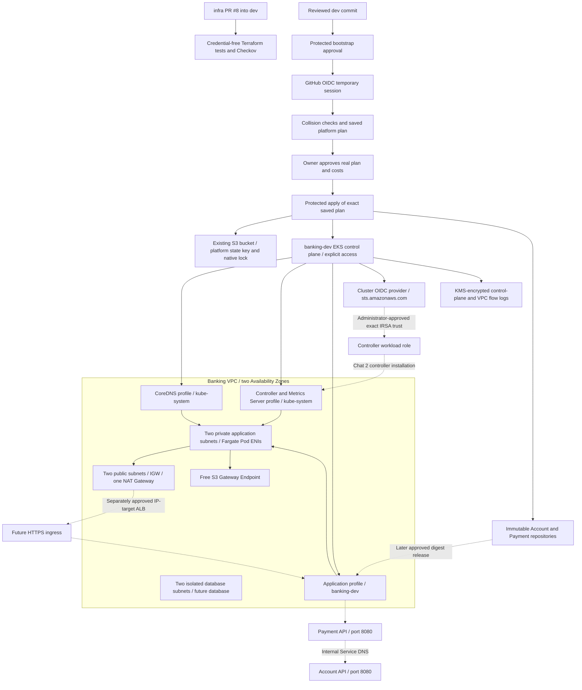

# Phase 3 EKS Fargate architecture

Prepared source only. PR #8 remains infra -> dev; no paid deployment or IAM modification has run for this redesign.

Fargate provisions one isolated compute environment per matching Pod. There are no managed EC2 worker nodes, launch templates, EBS worker disks or node AMI pins. The execution role is for the Fargate kubelet and ECR pulls; containers cannot use it as an application IAM identity. Controller AWS calls use the separate IRSA role and the cluster's actual OIDC issuer. GitHub OIDC continues to use the existing GitHub provider and protected bootstrap subject; those trust relationships remain unchanged.

Three profiles use both private application subnets: CoreDNS, controller plus Metrics Server, and all banking-dev Pods. Creation is sequential, after NAT/private routes exist. CoreDNS explicitly uses computeType Fargate, two replicas, equal requests/limits and no topology spread configuration. Metrics Server uses the AWS community add-on (serving port 10251) with equal requests/limits. Exact add-on pins, amd64/Fargate compute compatibility and AWS configuration schemas are verified read-only before any live plan.

Fargate supplies its host CNI and kube-proxy. Terraform does not install VPC CNI, kube-proxy or Pod Identity agent DaemonSets. AWS VPC CNI NetworkPolicy enforcement, DaemonSets, privileged/host-network workloads, EBS volumes and topologySpreadConstraints are unavailable here. Metrics Server is for current utilization/HPA; historical dashboards still need the later monitoring phase. See [the handoff contract](INTERFACE.md) and [AWS Fargate limitations](https://docs.aws.amazon.com/eks/latest/userguide/fargate.html).

The EKS-managed cluster security group attaches to Fargate ENIs and control-plane interfaces. Its self-traffic rule supports DNS, API 443, application 8080, kubelet 10250, Metrics Server 10251 and controller webhook 9443. Its AWS defaults include broad outbound access; private routes and NAT constrain reachability but do not provide workload-level egress isolation. The new VPC's unused default security group explicitly denies ingress/egress. No unrelated security group is adopted or modified. Additional Pod security groups or workload isolation require a reviewed later design.

One NAT in the first AZ is a lab cost/availability tradeoff. Fargate does not guarantee even Pod placement across selected subnets; two replicas alone do not prove multi-AZ availability. An even-spread requirement needs per-AZ profiles and corresponding workload deployment changes reviewed with Chat 2. Database subnets have no Internet/NAT route. No RDS or ALB exists from this preparation, and the state bucket is outside the VPC.

Read-only earlier Ohio inventory found four VPC primary ranges (10.20/16, 10.50/16, 10.60/16 and 172.31/16), two other EKS clusters and no proposed Banking ECR names. Proposed 10.70.0.0/16 avoids those observed primary ranges; the protected runtime preflight checks all primary/secondary associations again. Those observations do not authorize reuse, establish quotas or prove SCP permissions.
