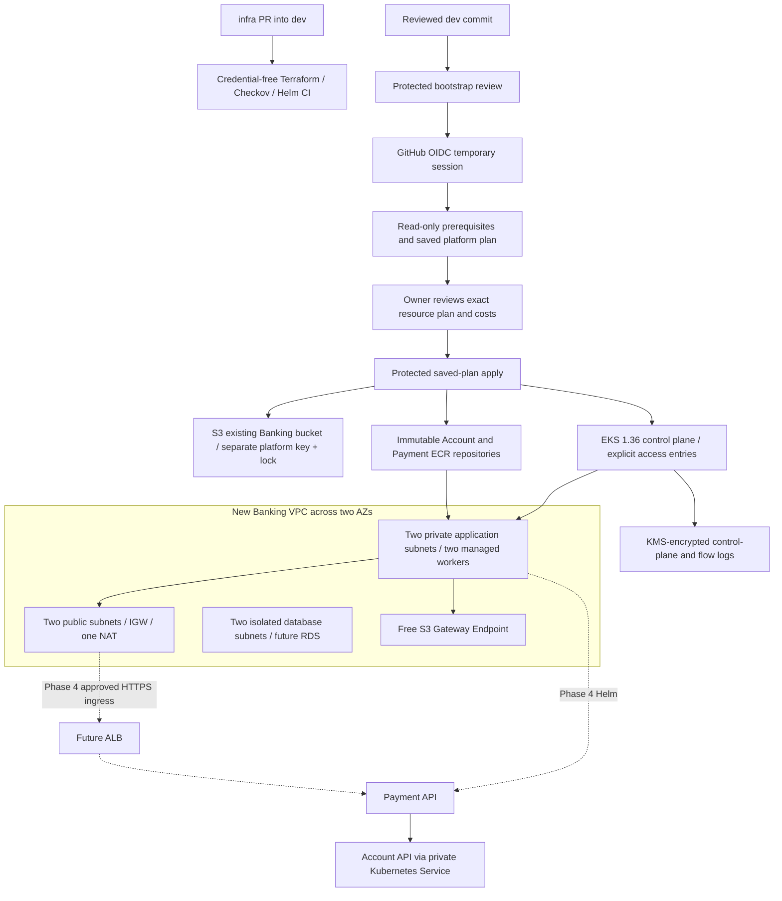

# Phase 3 architecture and shared-account boundaries

The state bucket is outside the VPC. Database subnets are reserved only; no database is provisioned. The dotted application/ALB paths are prepared future deployments, not running resources.

Read-only AWS Console inventory on 11 October 2026 found four existing Ohio VPCs with primary CIDRs `10.20.0.0/16`, `10.50.0.0/16`, `10.60.0.0/16` and `172.31.0.0/16`; two active EKS clusters (`cloudbatch818-zein-hcsecops`, `guduf-retail-eks-dev`); eighteen ECR repositories, none with either proposed Banking name. IAM role prefix search `cloudbatch818-mahmoud` returned the bootstrap and four CloudOps deploy roles, with no Banking cluster/node/flow/controller roles. These observations do not establish authorization to reuse other projects or prove quotas/SCPs permit a new cluster.

Proposed CIDR `10.70.0.0/16` does not overlap those observed primary ranges. The runtime preflight checks all primary/secondary CIDR associations and available AZs again before a live plan. It refuses to adopt existing Banking names, shared resources or unknown IAM identities. State, names and tags are project specific.

The previous CloudOpsTracker OIDC/S3 pattern informed protected workflows and backend separation. The read-only healthcare example informed separate AWS/Helm stages, digest releases and explicit role prerequisites, but its Fargate/DynamoDB design and resource names are not used. Banking uses two ASP.NET APIs, managed EC2 nodes and future relational storage.
