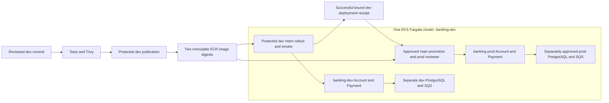

# Shared-cluster development and production demonstration

Approved architecture, pending code review and live acceptance. One EKS cluster,
banking-dev, in account 866934333672/us-east-2. No second cluster or EC2 workers.
The existing S3 backend and reusable branches remain preserved.

| Release | Branch / GitHub environment | Namespace | Existing application identity |
| --- | --- | --- | --- |
| Development | dev / dev | banking-dev | cloudbatch818-mahmoud-cloudops-deploy-dev |
| Production demonstration | main / prod | banking-prod | cloudbatch818-mahmoud-cloudops-deploy-prod |

Four Fargate profiles schedule CoreDNS, controller/Metrics Server, banking-dev and
banking-prod. Actual profile ACTIVE status and scheduling must be proven live.
The saved initial-plan guard expects 46 managed entries (45 AWS, one local), 33
taggable entries, one cluster, three access entries, four profiles and only the
operator's cluster-admin access-policy association. Terraform mocks are not a live plan.
Prod namespace profile/access entry have Environment=prod; shared platform stays dev.

## Release and permission controls

APP_RELEASE_MODE=shared-cluster-demo enables only dev and prod workloads. Successful
dev publication and deployment, exact digest manifest, source ancestry, trusted
workflow/run and v2 receipt are required before prod. The receipt binds cluster,
namespace, release mode, source/deploy commits, digest manifest hash and run IDs.
Legacy unbound receipts cannot authorize this demonstration mode. Production never
builds or publishes images. The six approved repository PR routes remain unchanged:
dev -> stage -> uat -> main still promotes code, with no stage/UAT AWS deployment.

GitHub dev/main-only environment restrictions, owner review, no admin bypass,
APP_DEPLOYMENTS_ENABLED=false and APP_DATA_OPERATIONS_ENABLED=false remain required.
The empty runtime JSON is not deployment-ready configuration. Terraform and Helm
execution still need their separate live authorizations and reviewer gates.

Deployment actions receive a restrictive STS session policy: dev image publication
or image reads plus discovery of banking-dev. The inline Banking allow policies
do not narrow retained CloudOps policies. Both full role trusts, every inline policy,
all six original managed policies/current default versions, boundaries, visible SCP
denies and session constraints require audit. No role least-privilege claim is made.
If retained permissions are excessive, propose separately approved isolated Banking
identities; preserve the existing CloudOps roles and their original relationships.

Operator installs helm/banking/namespaces/*.yaml and
iam/phase3/deployer-verification-rbac.yaml. Application access entries use distinct
banking-release-dev/prod groups and no AmazonEKSEditPolicy association. Namespaced
Roles permit Helm release objects, API Deployments/Services and release Secrets,
with read-only verification of their namespace and nodes. No Role/Binding creation,
other-namespace access or cluster mutation is granted. Release Secrets include Helm
history and potentially own-namespace runtime credentials: the deployer is trusted
within its own namespace. scripts/deploy/isolation.py fails before Helm if actual
authorization permits foreign access or cluster/RBAC mutation. It must pass live for
both principals; read-only YAML tests cannot prove effective EKS authorization.
Direct Pod deletion requires the approved operator; separately authorized rollout
restart uses the deployer's own Deployment patch right. Operator bootstrap is not
performed by an application job.

Namespace quotas bound each namespace to ten Pods, 2.5 vCPU and 5GiB of requests/
limits, with zero NodePort/LoadBalancer Services. Default two replicas/API fits;
four replicas/API plus its two rollout surges fits. Additional monitoring collectors
need reviewed sizing/quota changes. Fargate peak quota review requires 7.0 vCPU
available after actual regional usage, including system/controller/API surges.

## Security limits and data separation

Namespace RBAC separates Banking grants, but shared IAM permissions must also be
audited. Both environments share cluster/network and Fargate execution role. EKS
Fargate does not enforce VPC CNI NetworkPolicy; the banking NetworkPolicy manifests
are intent, not verified network isolation. Shared cluster/database security-group
reachability is coarse. Do not claim this training architecture is a hard production
tenant boundary. Separate credentials, resource ARNs and application authorization
are essential. See the AWS Fargate/CNI documentation linked in ARCHITECTURE.md.

Dev data root/state remains infra/environments/dev/data and
banking-release-platform/dev/data/terraform.tfstate. Prepared prod data root/state
is infra/environments/prod/data and banking-release-platform/prod/data/terraform.tfstate:
its own banking-prod-postgres, payment source/DLQ, master secret, monitoring role,
alarms/logs, runtime logins and Payment IRSA. It reads the shared platform VPC.
No dev credentials, queue or durable data may be reused for prod.

Protected data-operations currently targets DEV ONLY. Production data execution and
runtime persistence are deliberately blocked until a separate resource/cost/IAM
approval and reviewed protected prod data workflow/session cap. Initial prod memory
mode is an application demonstration, not completed durable production acceptance.
Both data roots have offline mocked tests, not live resources. Separate IRSA subjects
must be system:serviceaccount:banking-dev:banking-payment and
system:serviceaccount:banking-prod:banking-payment, and separate runtime secret access.

## Actual acceptance sequence

1. Merge reviewed code; complete the read-only AWS audit and one administrator handoff.
2. Verify actual service roles/operator/KMS, exact add-on catalog pins, CIDRs/AZs,
   runner connectivity and available quotas. Preserve any existing resources/state.
3. Request protected initial live-plan authorization. Review actual plan, tags,
   IAM references, inventory and costs; obtain separate apply authorization.
4. Verify ACTIVE cluster/profiles, DNS/Metrics Server, access entries and clean state.
   Operator installs namespaces/quotas/RBAC; collect both can-i denial results.
5. Authorize dev publication/deployment and enable switches only for that operation.
   Record digests, run links, Fargate Pod capacity, probes/DNS/API smoke results.
6. Promote approved code through existing branch routes, then authorize protected
   prod deployment of the same digest pair with successful dev evidence. Snapshot
   dev release/pod digests before/after and prove dev stays healthy.
7. Separately authorize each actual data/ingress/monitoring plan and cost exposure.
   Verify TLS, migrations/replay/outbox/SQS/DLQ, secrets/IRSA, logs and delivered alert.
8. Run controlled failed-release rollback, operator Pod replacement and bounded scaling.
   Capture logs/events/revisions and durable records. Update ACCEPTANCE.md from evidence.

No deployment evidence is fabricated and no resources are automatically destroyed.
