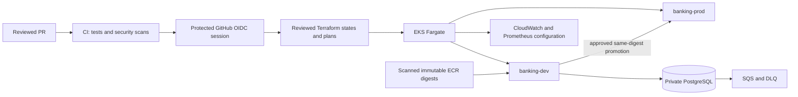

# AWS infrastructure

This directory contains the Banking project's Terraform roots, IAM documents, monitoring configuration, cost inputs and operational acceptance material. The target is a private EKS Fargate platform for the synthetic Account and Payment APIs in `us-east-2`. Source code and successful offline checks are not proof that a live service is deployed; see [project history and evidence](PROJECT-HISTORY.md).

## Architecture and boundaries

GitHub Actions uses OIDC and short-lived credentials. Protected stages review saved Terraform plans and apply only the reviewed binary plan. Separate Terraform states isolate the existing backend/bootstrap, VPC seed, service IAM, policy prerequisites, runtime foundation, platform, data services and CodeBuild deployment runner. The state bucket and its history are retained through project cleanup. State keys, backend settings, resource addresses, imports, provider locks and `prevent_destroy` protections are part of the deployment contract.

The platform uses a two-AZ VPC, public subnets for egress, private Fargate subnets, isolated database subnets, a NAT gateway and an S3 gateway endpoint. EKS runs CoreDNS, system/controller/metrics workloads and the two Banking namespaces on Fargate. Account and Payment communicate through namespace-local Kubernetes Services. ECR images are immutable and published with provenance. RDS, Secrets Manager, KMS, SQS/DLQ, CloudWatch and Prometheus/Grafana configuration have separate state or runtime interfaces.

Fargate has constraints: no managed worker nodes, DaemonSets, Pod Identity agent, EBS worker disks, VPC CNI NetworkPolicy enforcement or topology spread guarantees. The single NAT gateway and single-AZ data design are training cost/availability tradeoffs, not high-availability claims. Review each workload's availability and failure limits before presenting it as production-ready.

## Terraform roots

`infra/bootstrap` and `infra/backend` own the existing protected state foundation. `infra/network-seed` verifies and exports the VPC seed interface. `infra/iam-prerequisites`, `infra/policy-prerequisites` and `infra/runtime-foundation` manage their own bounded IAM/key state. `infra/environments/dev/platform` owns the EKS/VPC/ECR platform; `infra/environments/dev/data` and `infra/environments/prod/data` keep data environments separate. `infra/runtime-prerequisites` owns runtime prerequisites and alerts, while `infra/runner` owns the ephemeral private deployment runner. Shared reusable resources remain under `infra/modules/`.

Use each root's committed provider lock file and the backend configuration supplied by its protected workflow. Do not combine roots, change state keys, adopt unrelated resources or run local apply/destroy. Read-only plans and code validation still need the correct reviewed workflow context for account data.

## Find the right guide

- [Operations, approvals, cleanup and recovery](OPERATIONS.md)
- [Database, migrations, payments and SQS behavior](DATA.md)
- [Assignment requirements and acceptance evidence](REQUIREMENTS.md)
- [Historical project checkpoints and linked GitHub evidence](PROJECT-HISTORY.md)
- [Timed project demonstration](DEMO.md)
- [IAM proposals and ownership](iam/README.md)
- [Monitoring configuration](monitoring/README.md)
- Cost assumptions consumed by scripts are in `infra/cost/`.

## Automation scripts

Invoke scripts from the repository root unless a workflow changes directories. `scripts/bootstrap/` checks the GitHub/AWS bootstrap contract, state bucket and reviewed plans. `scripts/infra/` validates scoped inputs, IAM contracts, saved plans and outputs, estimates cost, prepares handoffs and checks cleanup inventories. `scripts/deploy/` builds and scans images, validates Helm and monitoring, verifies immutable release provenance, deploys, runs local integration checks and rolls back. `scripts/governance/` validates trusted PR metadata and repository path ownership; it reads GitHub metadata and must never execute PR-provided code.

Run the offline application suite with `python scripts/deploy/offline.py`, infrastructure Python tests with `python -m unittest discover -s scripts/infra/tests -v`, bootstrap tests with `python -m unittest discover -s scripts/bootstrap/tests -v`, and governance tests with `python -m unittest discover -s scripts/governance/tests -v`. Read [operations](OPERATIONS.md) before protected deployment or cleanup workflows.
